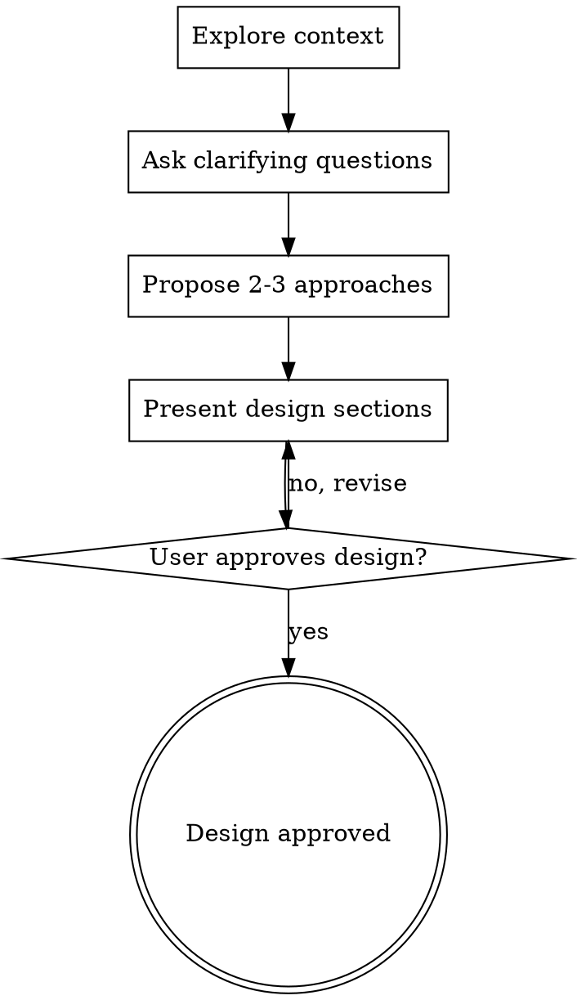

# Brainstorming Ideas Into Designs

## Overview

Help turn ideas into fully formed designs and specs through natural collaborative dialogue.

Start by understanding the current project context, then ask questions one at a time to refine the idea. Once you understand what you're building, present the design and get user approval.

<HARD-GATE>
Do NOT produce the deliverable or take any implementation action until you have presented a design and the user has approved it. This applies to EVERY task regardless of perceived simplicity.
</HARD-GATE>

## Anti-Pattern: "This Is Too Simple To Need A Design"

Every project goes through this process. A todo list, a single-function utility, a config change — all of them. "Simple" projects are where unexamined assumptions cause the most wasted work. The design can be short (a few sentences for truly simple projects), but you MUST present it and get approval.

## Checklist

You MUST create a task for each of these items and complete them in order (trivial tasks may collapse items 3-4 — see Fast Path):

1. **Explore context** — check files, docs, recent commits, or whatever material the task depends on
2. **Ask clarifying questions** — one at a time, understand purpose/constraints/success criteria
3. **Propose 2-3 approaches** — with trade-offs and your recommendation (trivial tasks: see Fast Path — a single one-line approach suffices)
4. **Present design** — in sections scaled to their complexity, get user approval after each section

## Fast Path (Trivial Tasks)

When the task is trivial and the approach is obvious (a rename, a config value change, a one-line fix), you do NOT need the full multi-approach process. Collapse it:

1. State the approach in one or two sentences.
2. Get explicit approval — the HARD-GATE still applies, so nothing is produced before the user approves.
3. On approval, proceed directly to execution — no need to present the full Handoff routing menu for a trivial task.

This is a sanctioned exception to Checklist items 3-4: for trivial tasks a single one-line approach satisfies the design-and-approval requirement. It is the pressure valve that keeps the clarify-to-brainstorming handoff painless — trivial work passes through in a single confirm, non-trivial work gets the full process below.

## Bugs: Investigate Root Cause First

If the task is a bug whose root cause is not yet known, finding the cause IS the first solution-finding step — you cannot design a fix for a cause you have not found. Trigger `systematic-debugging` to diagnose the root cause first, then return here to design the fix and get approval. Clarification only captured the symptom/repro/scope; the investigation belongs to this solve phase, not to `clarify-requirements`.

## Process Flow



**The terminal state is an approved design.** Do NOT produce the deliverable, create any files, or start implementation. Proceed to the Handoff section.

## The Process

**Understanding the idea:**
- Check out the current project state first (files, docs, recent commits)
- Ask questions one at a time to refine the idea
- Prefer multiple choice questions when possible, but open-ended is fine too
- Only one question per message - if a topic needs more exploration, break it into multiple questions
- Focus on understanding: purpose, constraints, success criteria

**Exploring approaches:**
- Propose 2-3 different approaches with trade-offs
- Present options conversationally with your recommendation and reasoning
- Lead with your recommended option and explain why

**Presenting the design:**
- Once you believe you understand what you're building, present the design
- Scale each section to its complexity: a few sentences if straightforward, up to 200-300 words if nuanced
- Ask after each section whether it looks right so far
- Cover the decisions that shape the deliverable
- Be ready to go back and clarify if something doesn't make sense

## Handoff

When the user approves the design, present routing options via the question channel. Include the agent's recommendation based on design complexity, but the user decides.

```
### Question N: Design approved. What's the next step?

(<agent's brief rationale — e.g., "This design has 5 tasks across 3 modules —
I'd recommend a formal plan." or "This is a single-file change — executing
directly should work fine." If a separate or cheaper agent will run it in a
new session, recommend the handoff plan.>)

- **A)** Write a formal implementation plan — standard, same session (`writing-plans`)
- **B)** Write a formal implementation plan — handoff / self-contained, for a different agent or new session (`writing-plans`)
- **C)** Execute directly — produce the deliverable from the approved design (no written plan)
- **D)** Other (please specify)

### Question N+1: Update memory file with the approved design?

- **A)** Yes
- **B)** No, proceed without updating
```

**Rules:**
- The memory file question is bundled in the same interaction — not a separate call.
- If the user picks A or B (plan), trigger `writing-plans` — pass the chosen mode (standard for A, handoff / self-contained for B).
- If the user picks C (execute directly), proceed to implementation. `skill-runtime-policies` Rule 8 still applies after completion.
- Per `skill-runtime-policies` Rule 7, name the target skill explicitly when proposing the transition.

## Key Principles

- **One question at a time** - Don't overwhelm with multiple questions
- **Multiple choice preferred** - Easier to answer than open-ended when possible
- **YAGNI ruthlessly** - Remove unnecessary features from all designs
- **Explore alternatives** - Always propose 2-3 approaches before settling
- **Incremental validation** - Present design, get approval before moving on
- **Be flexible** - Go back and clarify when something doesn't make sense
