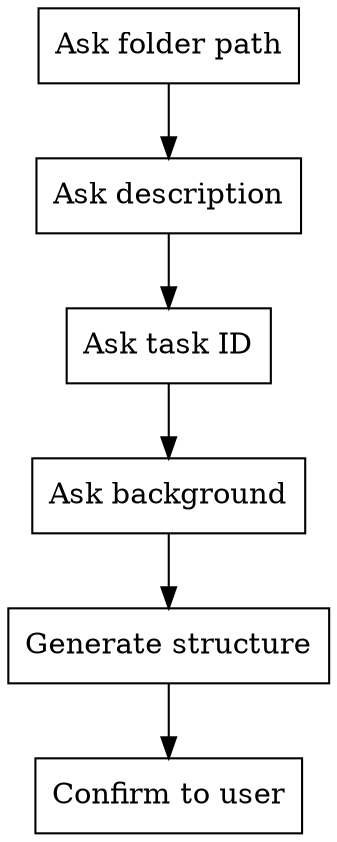

# Initializing Task Folder

## Overview

Create a standardized, self-contained documentation folder for any work item. The folder uses a fixed structure with universal naming regardless of task type (epic, incident, research, design, etc.).

## When to Use

- User says "start a new task/topic/project"
- User wants to organize a new epic, incident, research spike, or design effort
- User needs a documentation folder for ongoing work that will involve meetings, research, or decision tracking

## Process



### Step 1: Gather Information via the question channel

Ask these in a **single** question-channel prompt:

```
I'll set up a new task documentation folder. Please provide:

1. **Folder path** — where to create it (e.g., d:\git\scratches\epic_and_task\my-new-task)
2. **Brief description** — one-liner for the README Goal (e.g., "Integrate booking4med with Modern RIS Booking API")
3. **Task ID** (optional) — Jira/tracker ID (e.g., MRP-116, INC-042) or "none"
4. **Background** — why does this task exist? How does it fit into the bigger picture? Who's involved? What systems are affected? (This fills the README Background section. Provide as much or as little as you like.)
```

Use the `clarify-requirements` skill to probe for background context if the user's response is thin. The richer the initial context, the more useful the folder is from the first session.

### Step 2: Generate Folder Structure

Create this exact structure:

```
{folder-name}/
├── README.md
├── tracker.md
├── quick-notes.txt
├── topics/.gitkeep
├── meetings/.gitkeep
├── my-research/.gitkeep
├── raw/.gitkeep
├── memory/.gitkeep
└── retired/.gitkeep
```

### Step 3: Generate File Contents

Use the templates in `templates.md` (companion file in this skill directory). Substitute:
- `{TASK_ID}` — from user input (or omit if "none")
- `{TASK_DESCRIPTION}` — from user input
- `{BACKGROUND}` — from user input (for README Background section)
- `{FOLDER_NAME}` — the folder name portion of the path
- `{DATE}` — today's date in YYYY-MM-DD

If the background text mentions specific people (stakeholders, participants, team members), pre-populate the Key People table in `tracker.md` with their names and roles.

If a task ID is provided, pre-populate the External References > Project Links section in `tracker.md` with the Jira link and a brief summary (e.g., "Parent epic for [description]. Tracks Jira sub-tasks and sprint planning.").

### Step 4: Confirm

Report what was created in plain chat.

## Quick Reference

| File/Folder | Purpose |
|---|---|
| `README.md` | Entry point — project identity, background, workflow reference, folder usage instructions |
| `tracker.md` | Single flat tracker for all items + Key People + File Registry + External References (project links and consulted resources) |
| `quick-notes.txt` | Personal scratch pad (not for AI) |
| `topics/` | Self-contained knowledge documents by topic area |
| `meetings/` | Per-meeting notes |
| `my-research/` | Individual analysis, homework output |
| `raw/` | Source materials (transcripts, specs, images) |
| `memory/` | AI session persistence |
| `retired/` | Superseded documents |

## Common Mistakes

- **Forgetting `.gitkeep`** — empty folders won't be tracked by git without it
- **Customizing folder names** — always use the universal names above, regardless of task type
- **Putting folder conventions in a central file** — each task folder must be self-contained; README contains all instructions
- **Not completing the update cascade** — writing a meeting note but forgetting to update `topics/` and `tracker.md`; always follow the full chain in the Workflow Quick Reference
- **Duplicating status tracking** — track status only in `tracker.md`, not scattered across multiple files
- **Treating `topics/` as brief summaries** — they are knowledge documents; write as much detail as needed to fully explain the topic
